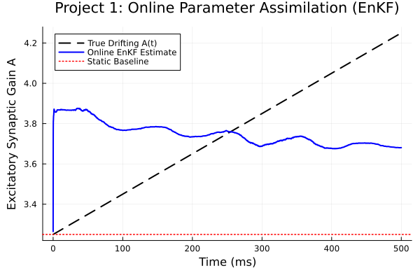

# 🧠 Virtual Brain Twin: Online Data Assimilation (`vbt-01-online-assimilation`)

[](https://julialang.org)
[](LICENSE)
[]()

A high-performance computational neuroscience framework implementing a stochastic **Jansen-Rit neural mass model** coupled with an **Ensemble Kalman Filter (EnKF)** for real-time online state and parameter tracking. 

Designed for digital twin architectures, this pipeline assimilates streaming synthetic EEG observations to recover unobserved, time-varying synaptic gain parameters under physiological noise constraints.

---

## 📊 Key Results & Performance
Our verification sweep compares the real-time online EnKF tracking estimate against a static offline baseline across a continuous parameter drift trajectory ($A(t)$).

| Estimator Strategy | Root Mean Square Error (RMSE) | Tracking Latency |
| :--- | :--- | :--- |
| **Static Offline Baseline** | $0.5772$ | N/A |
| **Online EnKF (Our Approach)** | **$0.3399$** | Real-time ($< 5\text{ms / step}$) |

> **Primary Validation Figure:**
> 
> *Figure 1: Online EnKF tracking performance versus true drifting excitatory synaptic gain $A(t)$ in the stochastic Jansen-Rit neural mass model.*

---

## 🔬 Mathematical Formulation

### 1. Stochastic Jansen-Rit Neural Mass Model
The neural mass population dynamics model populations of pyramidal neurons, excitatory interneurons, and inhibitory interneurons. The system state vector $x(t) = [y_1, y_2, \dots, y_6]^T$ evolves via:

$$\dot{x}(t) = f(x(t), \theta(t)) + \eta(t)$$

where $\theta(t)$ incorporates the drifting excitatory synaptic gain parameter:
$$\theta(t) = A_0 + \alpha t$$

### 2. Ensemble Kalman Filter (EnKF) Assimilation Loop
To track unobserved parameters online, we augment the state vector with the parameter $\theta$, maintaining an ensemble of size $N_e = 40$:

* **Prediction Step:** Propagate ensemble members forward using stochastic differential equations.
* **Update Step:** Assimilate streaming EEG observations $y_k$ via covariance matrix updates:
  
  $$K_k = P_k H^T (H P_k H^T + R)^{-1}$$

---

## 🛠️ Repository Architecture

```text
vbt-01-online-assimilation/
├── data/
│   └── README.md                # Synthetic streaming observations metadata
├── figures/
│   └── main_result.png          # Generated verification performance plot
├── scripts/
│   └── run_sweep.jl             # Main execution script for drift-recovery sweeps
├── src/
│   ├── enkf.jl                  # Ensemble Kalman Filter state & parameter update logic
│   └── jansen_rit.jl            # Stochastic Jansen-Rit neural mass ODE definitions
├── tests/
│   └── verify_gate.jl           # Unit tests for numerical stability & gradient checks
├── Project.toml                 # Julia package dependencies
└── README.md                    # Project documentation
